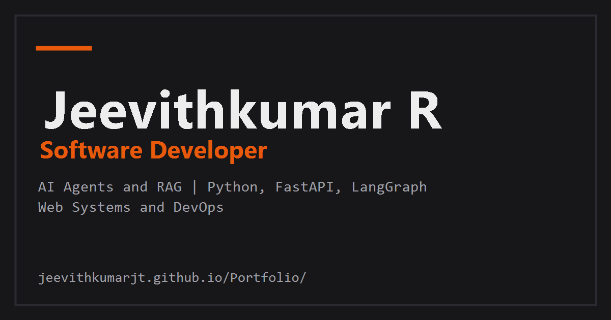

# Jeevithkumar R | Software Developer Portfolio

Personal portfolio of Jeevithkumar R, Software Developer building AI agents and web systems — hand-written HTML, CSS and vanilla JavaScript, no framework.

**Live:** https://jeevithkumarjt.github.io/Portfolio/



## Tech used

- HTML, CSS and vanilla JavaScript — no framework, no build step
- GitHub Pages hosting
- Self-hosted Inter and JetBrains Mono fonts (latin subsets)
- Playwright screenshots of live client sites (WebP, lazy-loaded)

## Features

- System map: six-layer architecture diagram, click a layer to open its skills, each skill with a level tag and "Used in" proof links
- Project filters (All, AI, Dashboards, Platforms) with animated re-flow
- Blueprint reticle cursor on fine-pointer desktops
- Scroll reveal, animated counters, scroll progress bar, active-section nav
- Click-to-enlarge lightbox with keyboard close
- `prefers-reduced-motion` support and a readable no-JavaScript fallback
- SEO: canonical URL, Open Graph and Twitter cards, Person JSON-LD, sitemap.xml, robots.txt

## Run locally

```sh
python3 -m http.server 8080
```

Then open http://127.0.0.1:8080/ in a browser.

## Repo structure

```text
index.html              # the whole site, one page
css/style.css           # flat dark theme, one orange accent
js/main.js              # cursor, reveals, filters, lightbox, skill map
assets/fonts/           # self-hosted Inter + JetBrains Mono (woff2)
assets/projects/        # real site screenshots (WebP) + architecture diagrams (SVG)
og-image.png            # social preview image, 1200x630
sitemap.xml             # search-engine sitemap
robots.txt              # crawler rules
Jeevithkumar_R_Resume.pdf
```

## License

MIT — see [LICENSE](LICENSE).
